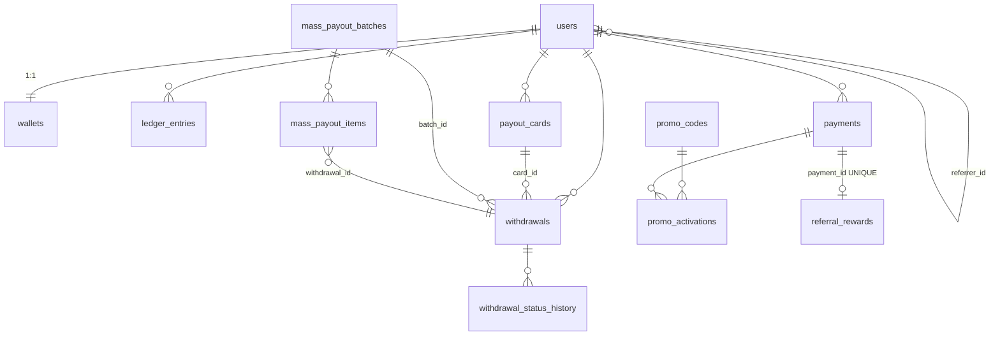

# Ma’lumotlar bazasi sxemasi

PostgreSQL. Migratsiya: `migrations/versions/20261006_0001_initial.py`. Pul ustunlari
`NUMERIC(18,2)`, vaqt `TIMESTAMPTZ`, enumlar `VARCHAR(32)`.

## Jadvallar

| Jadval | Vazifasi | Muhim cheklovlar |
|---|---|---|
| `users` | Telegram foydalanuvchi, telefon (ixtiyoriy), ban, referrer | `telegram_id` UNIQUE |
| `wallets` | `available`, `blocked`, `bonus_balance`, `total_deposit`, `total_withdraw`, `referral_earned`, `referral_withdrawn` | `user_id` UNIQUE, barcha balanslar `>= 0` (CHECK) |
| `ledger_entries` | **immutable** debit/credit: `account` (main/blocked/bonus/system), `reason`, `reference_*`, `external_tx_id`, `balance_after`, `status` | `idempotency_key` UNIQUE, `amount > 0`, UPDATE/DELETE trigger bilan taqiqlangan |
| `payments` | depozit: `ref` (UUID, provayderga), summa, komissiya, holat, `expires_at` | `ref` UNIQUE, `(provider, external_id)` UNIQUE |
| `webhook_events` | qabul qilingan provayder hodisalari | `(provider, event_id)` UNIQUE — idempotentlik |
| `payout_cards` | provayder tokeni + maskalangan raqam (PAN/CVV yo‘q) | `(provider, token)` UNIQUE |
| `withdrawals` | yechish/payout: summa, komissiya, `net_amount`, holat, `manual_required`, `attempts`, `next_attempt_at`, `source` (user/mass) | `ref` UNIQUE |
| `withdrawal_status_history` | **immutable** status tarixi (kim, qachon, izoh) | trigger |
| `mass_payout_batches` / `_items` | ommaviy to‘lov partiyasi va qatorlari, `fingerprint` (dublikat) | |
| `promo_codes` | fixed/percent, min depozit, umumiy/user limiti, muddat, `is_deleted` (soft) | `code` UNIQUE |
| `promo_activations` | pending (keyingi depozitga) / applied / expired | |
| `vip_levels` | nom, `min_total_deposit`, `bonus_percent`, tartib | |
| `referral_rewards` | har tasdiqlangan depozit uchun referal mukofoti | `payment_id` UNIQUE |
| `admins` | RBAC: superadmin/admin/operator/auditor, `from_env` | `telegram_id` UNIQUE |
| `audit_logs` | **immutable**: actor, action, entity, `before`/`after` (JSONB), izoh | trigger |
| `system_settings` | runtime sozlamalar (key/value) | PK `key` |
| `required_channels` | majburiy obuna kanallari, tartib, `bot_is_admin` | `username`, `chat_id` UNIQUE |
| `join_requests` | kanalga kirish so‘rovlari | |

## Pul oqimlari (ledger)

| Hodisa | Yozuvlar |
|---|---|
| Depozit tasdiqlandi | `main +net` (deposit), ixtiyoriy `main +` (vip_bonus, promo_bonus), referrer `bonus +` (referral_bonus) |
| Yechish arizasi | `main −amount`, `blocked +amount` (withdraw_hold) |
| Payout to‘landi | `blocked −amount` (withdraw_paid) |
| Rad etildi / provayder rad etdi | `blocked −amount`, `main +amount` (withdraw_release) |
| Referal bonusni yechish | `bonus −x`, `main +x` (referral_transfer) |
| Admin kredit/debet | `main ±x` (manual_credit/manual_debit) + `audit_logs` |
| Ommaviy to‘lov | `system −net` (mass_payout) — foydalanuvchi balansiga tegmaydi |

Invariant: `wallets.available + blocked + bonus_balance` = foydalanuvchining ledger yozuvlari
yig‘indisi (`credit − debit`, `system` hisobidan tashqari).

## Mob-Cash va P2P (migratsiya `0002_mobcash_p2p`)

| Jadval | Mazmuni | Cheklovlar |
|---|---|---|
| `p2p_cards` | foydalanuvchilar pul o‘tkazadigan kassir kartalari, `is_active` | `number` UNIQUE |
| `userbot_accounts` | bank xabarlarini o‘qiydigan Telegram akkauntlar; `session_encrypted` (Fernet), holat, oxirgi xato | `phone` UNIQUE |
| `bank_transactions` | userbot o‘qigan kirim xabari: summa, karta oxirgi 4 raqami, xom matn; matched / unmatched / ignored | (`owner_tg_id`, `source_chat_id`, `message_id`) UNIQUE |
| `p2p_deposits` | noyob summali depozit: `payer_id`, `amount` (so‘ralgan), `unique_amount` (to‘lanadigan), `credit_amount` (Mob-Cash'ga), holat, urinishlar, Mob-Cash javobi | `unique_amount` UNIQUE **WHERE status='pending'**; `bank_tx_id` UNIQUE |
| `mobcash_withdrawals` | Mob-Cash yechish arizasi: summa, komissiya, kartaga to‘lov, karta raqami, `code_mask` (kodning o‘zi saqlanmaydi) | |
| `users` (+2 ustun) | `mobcash_payer_id`, `payout_card_number` — oxirgi ishlatilganlar | |

Holatlar:

- `p2p_deposits`: `pending → paid → credited`; noaniq Mob-Cash javobi → `review` (admin);
  `pending → expired/cancelled` (grace davomida kechikkan to‘lov baribir `paid` bo‘ladi);
  admin → `rejected`.
- `mobcash_withdrawals`: `review` (so‘rov paytida) → `awaiting_payout` → `paid`;
  `awaiting_payout → refunded` (o‘yin hisobiga qaytarildi); rad etilgan → `failed`.
